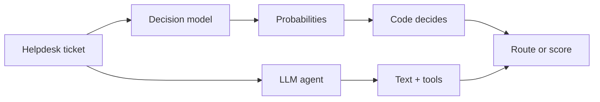
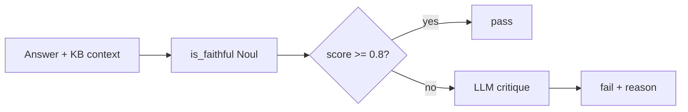
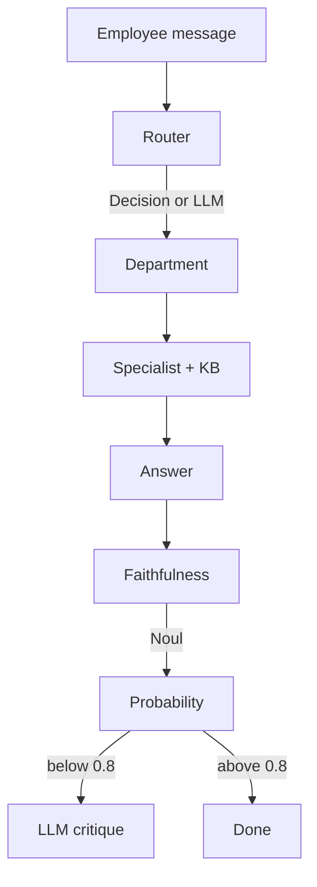

# Why decision models for routing and evals

This workshop uses a **System One / decision model** (via [LiteLLM](https://docs.litellm.ai/docs/decisions/) `asystemone`) for two jobs that look like “AI” but are really **judgments**:

1. **Routing** — which department should handle a ticket?
2. **Evaluation** — is an HR answer faithful to the retrieved knowledge base?

Chat models are good at conversation and tool use. Decision models answer **typed questions** with **calibrated probabilities**, so application code can threshold, log, and act. That split is the main idea: **the model judges, code decides**; LLMs still generate answers where we need language.

The default LiteLLM model here is OpenAI Decisions (`openai/gpt-6-luna`). Override with `DECISION_MODEL` for another provider (e.g. `typesafe/jev-1.14.0`).

For public benchmarks of the latest System One / decision models, see the [Artificial Analysis Decision Index](https://artificialanalysis.ai/evaluations/artificial-analysis-decision-index).

---

## How it differs from an LLM agent

| | LLM agent (e.g. `gpt-6-luna`) | Decision model |
| --- | --- | --- |
| Output | Free-form text + tool calls | Choice / Noul / Score with probabilities |
| Control | Prompt wording | Criteria + thresholds in code |
| Cost shape | Input + output tokens | Often input-heavy / judgment-shaped pricing |
| Best for | Writing, multi-step tools, RAG answers | Classify, gate, score |

---

## What we implemented

### Routing

Each ticket is scored with two questions in one System One request:

- **Noul** — is this a real helpdesk request?
- **Choice** — which department (IT, HR, Facilities, Finance, Legal, Security)?

Code applies thresholds (e.g. low Noul → `None` / not a ticket) and escalates. Confusing cases (employee expenses → HR vs vendor invoice → Finance) are spelled out in Choice criteria.

### Faithfulness eval (“AI as a judge”)

After the HR specialist answers from the KB:

1. Decision **Noul**: probability the response is faithful to retrieved context  
2. If score ≥ **0.8** → pass, no LLM call  
3. If below threshold → LLM critique (same prompt as the always-on judge)

That keeps expensive critiques for borderline or failing cases.

---

## Why this matters for evals and routing

1. **Fit the job** — classification and faithfulness are judgments; typed answers beat prose you have to parse.  
2. **Latency** — no tool loops for “which department?”  
3. **Cost** — hybrid evals reserve LLM spend for fails.  
4. **Control** — criteria and thresholds live next to code, easy to audit and change.  
5. **Complementary** — keep LLMs for generation and RAG; use a decision model to route and score.

Setup detail: [decision_router.md](decision_router.md), [decision_hr_judge.md](decision_hr_judge.md).

Public model comparison: [Artificial Analysis Decision Index](https://artificialanalysis.ai/evaluations/artificial-analysis-decision-index).

**Bottom line:** use chat models to generate; use a decision model to classify and score; use code to decide.
